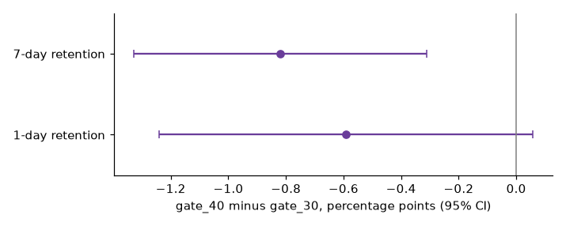
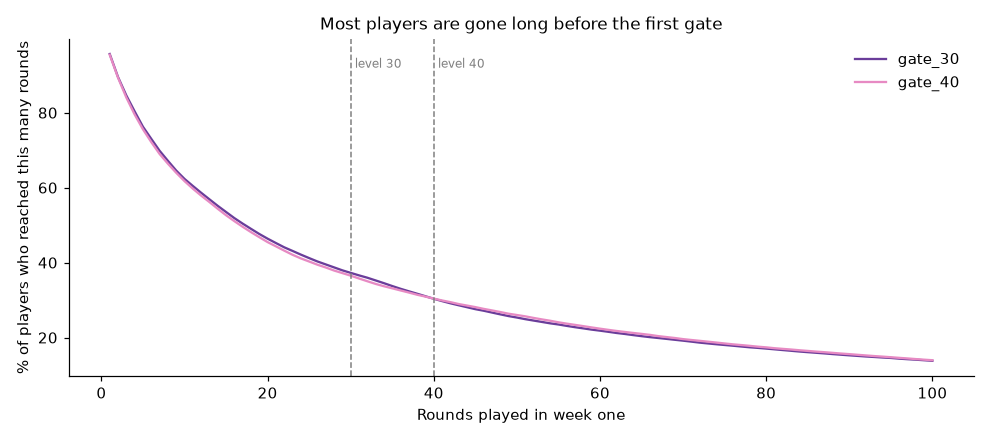

# Cookie Cats: Player Journey and A/B Test of the First Gate

**Decision:** keep the first gate at level 30, or move it to level 40, in the mobile puzzle game Cookie Cats.
**For:** a head of product / monetization.
**Data:** 90,189 new players randomly assigned to `gate_30` or `gate_40`, with 1-day retention, 7-day retention and rounds played in week one ([Kaggle: Mobile Games A/B Testing, Cookie Cats](https://www.kaggle.com/datasets/yufengsui/mobile-games-ab-testing)). The data has no revenue.

## Answer
**Keep the gate at level 30.** Moving it to level 40 lowers 7-day retention by **0.8 points** (19.0% to 18.2%; 95% CI −1.3 to −0.3; Holm-corrected p = 0.003). 1-day retention is inconclusive (−0.6 points, CI −1.2 to +0.06), and rounds played do not differ between versions.



## What the analysis covers
- **Player journey.** 4.4% of players never play a round, about 16% play two or fewer, and only about a third ever reach level 30, so the gate affects a minority of players and the full-sample effect is diluted.
- **Experiment checks.** Sample-ratio test, outlier check, and a power check (about 38,000 players per arm needed to detect 0.8 points; the test had about 45,000).
- **Effect on retention.** Analytic and bootstrap intervals agree, with Holm correction across the two retention metrics.
- **Robustness.** The conclusion is tested against the worst case for the sample-ratio issue.



## What the product team should know
- **The split fails the sample-ratio check (p = 0.009):** `gate_40` received 789 more players than `gate_30`. The direction of the result survives the worst case (still −0.66 points, CI excludes zero), but the size is less certain and the cause of the imbalance should be found.
- **There is no revenue in the data.** A later gate could raise or lower in-app purchases, so retention alone can't settle the business question. The next test should measure revenue per player.
- **One extreme player (49,854 rounds)** distorts the rounds metric but cannot affect retention.

## Run it
```
pip install -r requirements.txt
# download cookie_cats.csv from Kaggle into data/
jupyter notebook notebooks/cookie_cats_ab_test.ipynb
```
The data file is not included. Check the dataset's license on the Kaggle page before redistributing it.

## Repository
- `notebooks/cookie_cats_ab_test.ipynb`: the full analysis, executed
- `src/ab_stats.py`: statistics helpers (sample-ratio test, proportion and bootstrap intervals, power)
- `reports/figures/`: charts used above
